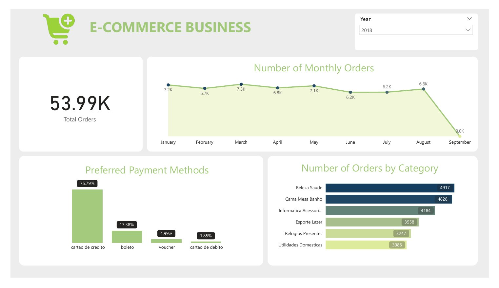

# 📊 E-commerce Sales Analysis (Power BI)

A Power BI dashboard built on a public Brazilian e-commerce dataset. It shows how many orders the business gets each month, how customers prefer to pay and which product categories sell most.

## 🎯 Business questions

- How many orders does the business get each month?
- Which payment methods do customers prefer?
- Which product categories get the most orders?

## 💡 Key insights (2018)

- **About 54,000 orders** in total, steady at roughly **6,000–7,000 a month**.
- **Credit card is the main payment method** (about 76% of orders), followed by *boleto* (a Brazilian bank slip, about 17%).
- **Health & beauty** and **bed, table & bath** are the categories with the most orders.
- The drop in September is not a real fall in sales: the data for that month is incomplete. Spotting this kind of gap is an important part of checking data before drawing conclusions.

## 🛠 What I did

- **Power Query:** cleaned and prepared the data.
- **DAX:** created measures for total orders and percentages by payment type.
- **Visuals:** KPI card, monthly trend, payment method chart and category ranking, with a year filter.

## 🔗 Files

- 📄 [Dashboard PDF](project1-e-commerce.pdf)
- 🌐 [Interactive version in Power BI](https://app.powerbi.com/view?r=eyJrIjoiYzY4ODkzMWQtNWE0Yy00NzkzLThmNjEtNTAzYjAzYzgwYzg0IiwidCI6ImU5M2QyNjRkLWE5NjAtNGY4ZS1iYjFmLWI3ODcwODY0MjVlOCJ9)

## 🧰 Tools

Power BI · Power Query · DAX
